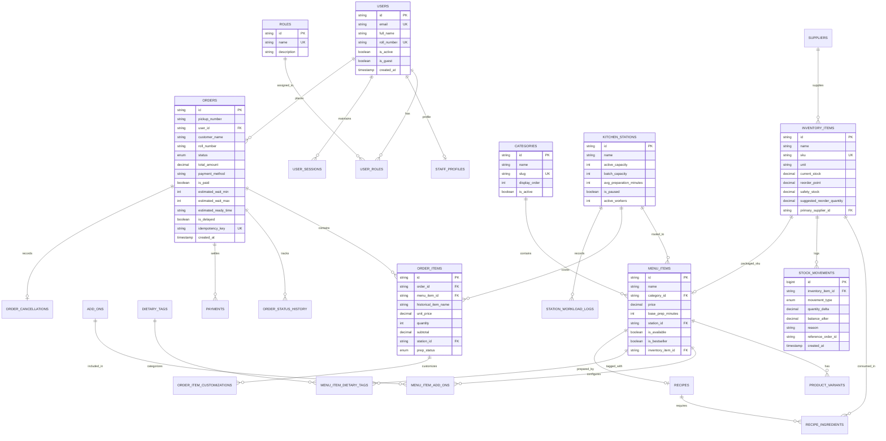

# Cafe Connect — Entity Relationship Diagram (ERD)

The following Mermaid entity relationship diagram documents the complete normalized relational data model for **Cafe Connect**.

---

## 🔗 Key Architectural Highlights

1. **Historical Immutability**:
   `order_items` stores `historical_item_name` and `unit_price` at the moment of order placement. If an admin modifies product prices or renames a dish, existing receipts and financial reporting remain 100% accurate.
2. **Station Decoupling**:
   Each `order_item` tracks its own `station_id` and `prep_status`. In a mixed order (e.g. Masala Dosa + Filter Coffee), the beverages station and breakfast griddle operate in parallel without locking each other.
3. **Automated Inventory Audit**:
   Every completion of an order writes to `stock_movements` with `movement_type = 'order_deduction'` and the exact delta, maintaining an audit trail for inventory tracking.
